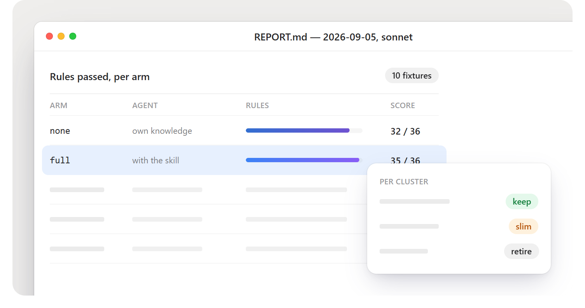

<p align="left">
  <picture>
    <source media="(prefers-color-scheme: dark)" srcset="docs/brand/agents-dark-bg.svg">
    
  </picture>
</p>

# design-engineering

[](https://skills.sh/AgentsORG/design-engineering)
[](https://github.com/AgentsORG/design-engineering/actions/workflows/ci.yml)
[](https://github.com/AgentsORG/design-engineering/releases)
[](LICENSE)

```bash
npx skills add AgentsORG/design-engineering
```

Design engineering for AI agents: the invisible details that make UI feel right, as a skill graph your coding agent loads, specialist agents that loop until the work passes, a cross-model design council, a grader for humans and agents, and benchmarks that prove each part earns its place. It runs in Claude Code, Codex, Cursor, Gemini and OpenCode.

It draws on Emil Kowalski's design-engineering practice, distilled by HKTITAN, [Benji Taylor](https://benji.org) ([Agentation](https://www.agentation.com), [Stageshow](https://benji.org/stageshow)), [Jakub Antalik](https://transitions.dev), [Jakub Krehel](https://jakub.kr), [James Frewin](https://guidelines.sh), [Vercel](https://vercel.com/design/guidelines), [Index](https://index.how), Apple's audio-haptic principles, and 47 launch films measured frame by frame. The full list is under [Sources](#sources).

## Install

**The skill** (Claude Code, Codex, Cursor, Gemini, OpenCode and every other agent skills.sh supports):

```bash
npx skills add AgentsORG/design-engineering
```

Then type `/design-engineering` in your agent.

**Everything else too.** One line sets up the skill, the Claude Code plugin, agents for every detected harness, the design-check hook, and (opt-in) the eve MCP server and companions:

```bash
curl -fsSL https://raw.githubusercontent.com/AgentsORG/design-engineering/main/install.sh | bash
```

```powershell
irm https://raw.githubusercontent.com/AgentsORG/design-engineering/main/install.ps1 | iex
```


Flags: `--dry-run` prints every change, `--only <parts>`, `--harness <list>`, `--yes`, `--with-hooks` / `--no-hooks`, `--with-mcp` (eve MCP), `--with-companions` (agentation, stageshow), `--uninstall`; on Windows the same switches are `-DryRun`, `-Only`, `-Harness`, `-Yes`, `-WithHooks` / `-NoHooks`, `-WithMcp`, `-WithCompanions`, `-Uninstall`. It is idempotent, backs up any settings file before editing it and never touches credentials. Pin a release with `curl -fsSL <url> | DE_REF=v4.0.0 bash` (or `$env:DE_REF='v4.0.0'` before `irm`). Every path the installer writes is listed under [Manual install](#manual-install).

## Paste this into your coding agent

Give your agent this block and it installs and checks itself:

```text
Install and verify the design-engineering skill and agents for this machine.

1. Run the installer for this OS, dry run first, and show me the plan:
   macOS/Linux: curl -fsSL https://raw.githubusercontent.com/AgentsORG/design-engineering/main/install.sh | bash -s -- --dry-run
   Windows:     & ([scriptblock]::Create((irm https://raw.githubusercontent.com/AgentsORG/design-engineering/main/install.ps1))) -DryRun
2. If the plan only touches the skill, agent, hook and backup paths it lists, run it again
   without the dry-run flag (add --yes / -Yes so it does not prompt).
3. Verify, and report each line as pass or fail:
   - SKILL.md exists in the harness's skill folder (~/.agents/skills, ~/.claude/skills,
     ~/.gemini/skills or ~/.config/opencode/skills, under design-engineering/)
   - /design-engineering with no arguments prints the verb menu
   - the agents are listed: design-council, design-judge, design-grader, ui-reviewer, motion-auditor
     (Claude Code: /agents; Codex: ~/.codex/agents; Cursor: ~/.cursor/agents;
      Gemini: ~/.gemini/agents; OpenCode: ~/.config/opencode/agents)
   - node <skill folder>/scripts/grade.mjs --self-test exits 0
   - ~/.config/design-engineering/manifest.txt lists everything that was written
4. Smoke test: run "/design-engineering review" on one CSS file in this repo and check the answer
   is a Before | After | Why table that cites node names like [[easing-curves]].
Never edit credentials. If a step fails, stop and show me the error.
```

## What you get

| Part | Claude Code | Codex | Cursor | Gemini | OpenCode |
| --- | --- | --- | --- | --- | --- |
| Skill graph and `/design-engineering` | plugin or skill | skill | skill | skill | skill |
| 13 specialist agents | plugin or `~/.claude/agents/` | `~/.codex/agents/*.toml` | `~/.cursor/agents/` | `~/.gemini/agents/` | `~/.config/opencode/agents/` |
| Loops (act, verify, fix, 3 rounds) | yes | yes | yes | yes | yes |
| Design council (`council.mjs`) | judge via `claude -p` | judge via `codex exec` | judge via `cursor-agent -p` | unscored jester via `gemini -p` | runs the runner |
| Grader (`grade.mjs`) | yes | yes | yes | yes | yes |
| Design-check hook | `PostToolUse`, non-blocking | not wired yet | not wired yet | not wired yet | not wired yet |
| eve MCP hand-off (opt-in) | `claude mcp add` | MCP settings | MCP settings | MCP settings | MCP settings |

Each agent is written once in `agents/<name>.md` and generated into every other harness's format by `scripts/build-agents.mjs`; CI fails on drift. Harness-by-harness detail is in [`harness/README.md`](harness/README.md).

## Verbs


Everything is reached through one skill: `/design-engineering [verb] [target]`. A plain request (`/design-engineering why does this card feel flat`) goes through the router to one owner node. With no arguments it shows the menu and suggests the two or three verbs that fit what is in front of it.

| Verb | Does |
|---|---|
| `review` | A UI code review as a Before / After / Why table, change-scoped for a diff |
| `polish` | The screen works but feels unfinished: states, optical details, fixes applied |
| `motion` | Whether it should move, then timing, easing and springs with concrete values |
| `tells` | AI-default tells in UI, code or copy, as a deletion list |
| `a11y` | An evidence-only accessibility audit tied to WCAG 2.2 criteria |
| `tokens` | Find the `.design` / DESIGN.md and thread its tokens through the UI |
| `sound` | Which moments earn a sound; one family, generated, wired, mapped |
| `council` | Cross-model judges score before/after evidence per category; loop until every judge passes |
| `grade` | Score a design episode, human or agent, on six axes with a band and a counterweight |
| `svg` | `create`, `animate` or `sticker` |
| `mobile` | A web app that feels native on a phone: the symptom, the one-line fix, what needs a real device |
| `break` | Realistic worst-case data until the layout breaks; reports and stops |
| `ship` | The whole-app production pass: every lane fixed and verified, then what needs a device or a human |
| `film` | `plan` a launch film, `review` a render, or `formats` |
| `diagram` · `options` · `pick` · `name` · `which` · `agentation` · `pov` | Draw or not; three directions behind a picker; the exact word; who owns a job; the annotation fix loop; fork taste or log a gotcha |


The 2.x slash commands (`/design-engineering:review-ui` and the rest) are gone; their names still work as aliases. Install the skill **one** way, either skills.sh (`/design-engineering`) or the plugin (`/design-engineering:design-engineering`). Installing both lists it twice.

## Agents and loops


Thirteen specialists, each a delegation target rather than an entry point (every verb runs without them):

| Agent | Job |
| --- | --- |
| `design-council` | Runs the council: fans one judge brief out to every available provider, loops to threshold |
| `design-judge` | One read-only judge: JSON scores per category, Before/After/Why evidence, confidence |
| `design-grader` | Grades a design episode for a human or an agent on the grading rubric |
| `ui-reviewer` | Before / After / Why review against the checklist |
| `motion-auditor` | Timing, easing, transform-only, reduced motion |
| `anti-pattern-scanner` | AI-default, copy and code tells, as a deletion list |
| `agentation-fix-loop` | Works through Agentation annotations until none are pending |
| `design-md-consumer` | Reads `.design` / DESIGN.md and threads tokens through the UI |
| `pov-curator` | Forks taste into `pov.md`, logs gotchas |
| `sound-designer` | One sound family, generated, wired and mapped to motion |
| `svg-creator`, `svg-animator` | Clean, token-aware SVG, then its animation |
| `launch-film-analyst` | Measures a launch film against the 47-film corpus |

Every agent carries a `## Loop`: act, verify with a deterministic check where one exists, fix; three rounds by default; a findings ledger (id, severity `blocker` / `should` / `nit`, outcome). A timeout or no reply is never approval, an agent never agrees just to end the loop, and the scope guard prefers deleting or narrowing over adding.

## Design council


`/design-engineering council` (or `@agent-design-council`) adapts Theo Browne's [tstack](https://github.com/t3dotgg/tstack) council (MIT) to design, the way Emil pairs a council with design and animation skills:

- **Three providers.** Claude through the `design-judge` subagent, GPT through `codex exec`, Gemini through `gemini -p` as an unscored jester when present. A missing provider is reported, never substituted.
- **Evidence, not code alone.** Judges see before/after screenshots or films plus reference products in the same panel, since isolated judging inflates scores. They never see the target threshold.
- **Per-category scores, 1 to 10.** Typography, hierarchy, colour and contrast, spacing and layout, motion, states, accessibility, copy.
- **Staged and looped.** Cheapest judge first; scarce judges join once it passes. Loop until every judge clears the threshold or the budget runs out; fork a fresh branch to push further. One human taste note is allowed mid-climb.
- **Recorded.** A `## Council review` table goes in the PR description: rounds, per-judge scores, and `no score` where a judge did not answer.

The runner is [`skills/design-engineering/scripts/council.mjs`](skills/design-engineering/scripts/council.mjs). It detects the `claude`, `codex`, `cursor-agent` and `gemini` CLIs, fans one judge brief out to each, and keeps a ledger of rounds (`--stage --threshold 9` runs the cheapest judge first; `--dry-run` shows the brief and sends nothing).

## Grader


`/design-engineering grade` scores a design episode (the brief, the diff or output, rendered evidence and, optionally, the transcript) the same way for a human, an agent with the skill, and an agent without it.

- **Checks first, judges second.** Deterministic signals run first: review-checklist rows, AI-default and code tells, WCAG numbers, motion values against the duration table, reduced motion, transform and opacity only, Stageshow film checks. Checks can only cap a score; only judges raise it.
- **Axes, 1 to 10.** Craft, Motion, Restraint, Access, Verification, and Direction when a human steered an agent. Each axis gets facts (Before/After/Why rows), an interpretation, a counterweight (the case against) and a confidence.
- **Bands.** generated (under 4), passable (4 to 6), crafted (6 to 8), refined (8 to 9), reference-grade (9 to 10). Confidence under 0.7 softens the wording, never the number.
- **Anti-gaming and privacy.** Results are cached by input hash (no re-rolls), claims that contradict the checks are flagged, and holdout briefs stay hidden. Everything runs locally; secrets are scrubbed before any model call, and `--dry-run` shows what would be sent.

The rubric is [`grading-rubric.md`](skills/design-engineering/references/meta/grading-rubric.md), the move catalog is [`design-moves.md`](skills/design-engineering/references/meta/design-moves.md), and the script is [`grade.mjs`](skills/design-engineering/scripts/grade.mjs): `node grade.mjs --files src/**/*.tsx --evidence after.png --judges claude,codex`, or `--checks-only` for the deterministic pass alone.

## Benchmarks



Same model in every arm; the only difference is how much of the skill the agent can see. `scripts/bench.mjs` runs three kinds of arm: `none`, `full`, and `minus-<cluster>` for each cluster on disk (plus `minus-agents`). Every run is a fresh `claude -p` in an empty workspace with an isolated plugin copy; the stream-json init line proves no user-installed copy leaked into the baseline, and a run that fails that check is excluded. It scores with the fixture rules and the grader's checks, records cost and tokens, labels any gap below the minimum detectable difference as noise, and gives each cluster a verdict: keep, slim or retire. The `claude plugin eval` suite under `evals/plugin/` runs the same with/without comparison inside Claude Code.

<!-- BENCH:START -->
| arm | rules passed | fixtures fully clean |
| --- | --- | --- |
| Sonnet, own knowledge | 32 / 36 (89%) | 7 / 10 |
| Sonnet + `/design-engineering` | 35 / 36 (97%) | 9 / 10 |

Run of 2026-09-05, ten scorable fixtures, one sample each: a floor check, not a leaderboard. Per-fixture results, every rule each arm missed and all twenty raw outputs are in [`evals/results/2026-09-05-sonnet/`](evals/results/2026-09-05-sonnet/REPORT.md). The skill fixed the card-hover edit (named transition properties, a `hover: hover` guard, a smaller lift), the dark-mode repair (a lifted surface instead of `#000`) and the icon toolbar (`hover: hover`). It still missed one thing: a login form shipped 15 px inputs, which zoom on iOS.
<!-- BENCH:END -->

Reproduce:

```bash
node scripts/bench.mjs --arms none,full --tries 3 --model sonnet            # with / without
node scripts/bench.mjs --arms all --tries 3 --relevant-only --concurrency 4  # every minus-<cluster> arm
node scripts/bench.mjs --report-only --out evals/results/<run>              # rebuild REPORT.md
node evals/run-bench.mjs evals/results/2026-09-05-sonnet                    # score the 2026-09-05 outputs
```

The eve evals in `evals/` are the other half: `defineEval()` checks for review format, motion values, sound values, launch-film numbers, the generated-modal floor, delegation and the council, run with `npm run eval`. The methodology is in `references/meta/design-benchmarks.md`.

## Sample prompts and outputs

Real outputs, unedited, from `claude -p --model sonnet` with the plugin loaded (2026-11-07).

<details>
<summary><code>/design-engineering review</code> a modal that pops from <code>scale(0)</code> on <code>ease-in</code></summary>

Prompt: `/design-engineering review this CSS and answer in at most 6 table rows: .modal{animation:pop .4s ease-in} @keyframes pop{from{transform:scale(0);opacity:0}to{transform:scale(1);opacity:1}} .btn:hover{transition:all .3s}`

| Before | After | Why |
|---|---|---|
| `animation: pop .4s ease-in` | `animation: pop .22s cubic-bezier(.23,1,.32,1)` | `ease-in` starts slow, so the modal feels hesitant when it appears. Entering elements want ease-out, and a modal should take roughly 200–250ms. |
| `from{transform:scale(0)…}` | `from{transform:scale(.95);opacity:0}` | Nothing in the real world appears from nothing, and scaling from 0 looks theatrical. Starting at about .95 with a fade reads as a quick settle. |
| `.modal` (no origin set) | `transform-origin: center` for a centered dialog. For a popover, use the trigger's origin. | The scale should grow from where the element belongs, not from a default that happens to fit. |
| `.btn:hover{transition:all .3s}` | `.btn{transition: background-color .15s ease-out, transform .15s ease-out}` | `all` animates layout properties and anything added later. Name the properties. 300ms is also too slow for hover feedback. |
| `.btn:hover{…}` (ungated) | `@media (hover:hover) and (pointer:fine){.btn:hover{…}}` | Touch devices keep hover styles after a tap (sticky hover), so gate them. |
| No reduced-motion handling | `@media (prefers-reduced-motion:reduce){.modal{animation:none}}`, or keep only the opacity fade | Scale and translate motion can trigger vestibular discomfort. Keep the fade and remove the movement. |

</details>

<details>
<summary><code>/design-engineering motion</code> a dropdown opening from a button</summary>

Prompt: `/design-engineering motion: a dropdown menu opens from a button. Give concrete duration, easing, transform-origin and the reduced-motion rule in under 120 words.`

Dropdown open (from [[responsive-feedback]], [[duration-table]], [[easing-curves]], [[prefers-reduced-motion]]):

- **Gate:** a dropdown is a popover, so it animates, but it's opened often. Keep it fast and make it interruptible.
- **Duration:** 150ms open (budget is 150–250ms). Exit is shorter at about 100ms and fades only.
- **Easing:** strong ease-out, `cubic-bezier(0.23, 1, 0.32, 1)`.
- **Properties:** `opacity` 0→1 and `scale(0.96)`→`1`. Never start from `scale(0)`.
- **Transform-origin:** the trigger's anchor, for example `top left` for a menu under a left-aligned button. Take it from Radix or Floating UI via `var(--transform-origin)`. Modals are the only element that stays centered.
- **Reduced motion:** under `prefers-reduced-motion: reduce`, drop the scale and keep a short opacity fade. Don't remove the state change.
- **Mechanics:** use a CSS transition, not a keyframe animation, so a rapid close/open reverses cleanly.

</details>

<details>
<summary><code>/design-engineering tells</code> a purple-gradient AI hero</summary>

Prompt: `/design-engineering tells: list the AI-default tells in this hero as a deletion list, max 6 bullets: <section class="bg-gradient-to-r from-purple-500 to-pink-500 text-center"><h1>✨ Supercharge your workflow with AI</h1>…`

1. **Delete the purple-to-pink gradient** (`bg-gradient-to-r from-purple-500 to-pink-500` on the `<section>`). Use a monochrome ground with one real accent. [[ai-default-tells]], [[color-monochromatic]]
2. **Delete the `✨` and `🚀` emoji** from the `<h1>` and the button. Emoji run 10% on top sites against 26% on weak ones, and they signal a generated page. [[ai-default-tells]]
3. **Replace the headline and subline** ("Supercharge your workflow with AI", "Unlock seamless, powerful productivity"). They could describe any product. Write one specific sentence saying what it does and for whom. [[content-authenticity]], [[ai-default-tells]]
4. **Replace "Get Started" with the action the button performs**, for example "Create project" or "Try it". [[ai-default-tells]]
5. **Swap `shadow-2xl` for a layered shadow at 4–6% opacity.** The heavy default shadow is a tell. Drop `rounded-full` too, and pick a radius from an intentional scale instead of the pill default. [[shadows-whisper]], [[border-radius]]
6. **Delete the layout.** A centered single column (`text-center` on a full-bleed section) with a headline, a line and a button is the default hero template. Make the layout fit your story. [[ai-default-tells]]

**Keep or enlarge:** keep the one-headline, one-action structure. Enlarge the proof by replacing the generic claim with a real product screenshot or a specific number.

</details>

<details>
<summary><code>/design-engineering sound</code> should Send make a sound?</summary>

Prompt: `/design-engineering sound: should a "Send" button in a chat app make a sound? Answer with a verdict and values in under 100 words.`

**Verdict: yes, but only as an opt-in, off-by-default confirmation, not a default press sound.**

- **Why:** Send is a daily action. It earns a sound only because attention has usually moved on to the next message.
- **Values:** one short tone, ≤250 ms. It should be soft and slightly rising, and 3 dB quieter than your first instinct. Fire it on send success, not on press.
- **Rules:** keep a visible sent state, since sound can't be the only signal. Add a discoverable mute toggle, and skip the sound on the 100th-use test if it would make you reach for mute.

</details>

<details>
<summary>One benchmark fixture, both arms: <code>edit-hover-01</code>, "Make the card lift on hover."</summary>

Input:

```css
.card { transition: all 0.3s ease-in; }
.card:hover { transform: translateY(-4px); box-shadow: 0 16px 32px rgba(0,0,0,0.3); }
```

Without the skill (3 of 5 rules):

```css
.card {
  transition: transform 0.2s ease-out, box-shadow 0.2s ease-out;
}
.card:hover {
  transform: translateY(-4px);
  box-shadow: 0 16px 32px rgba(0,0,0,0.3);
}
```

With the skill (5 of 5):

```css
.card {
  transition:
    transform 160ms cubic-bezier(0.25, 1, 0.5, 1),
    box-shadow 160ms cubic-bezier(0.25, 1, 0.5, 1);
}

@media (hover: hover) {
  .card:hover {
    transform: translateY(-1px);
    box-shadow:
      0 1px 1px rgba(17, 17, 17, 0.04),
      0 2px 4px rgba(17, 17, 17, 0.04);
  }
}

@media (prefers-reduced-motion: reduce) {
  .card {
    transition: box-shadow 160ms cubic-bezier(0.25, 1, 0.5, 1);
  }

  .card:hover {
    transform: none;
  }
}
```

</details>

## Manual install

The full reference, every path and command per harness, is [`docs/install.md`](docs/install.md). In short:

| Part | Command or path |
| --- | --- |
| Skill (any agent) | `npx skills add AgentsORG/design-engineering -g -y`, or copy `skills/design-engineering/` into the harness's skill folder |
| Claude Code plugin | `claude plugin marketplace add AgentsORG/design-engineering` then `claude plugin install design-engineering@agentsorg -s user` |
| Claude Code agents | copy `agents/*.md` to `~/.claude/agents/` (the plugin includes them) |
| Codex | skill in `~/.agents/skills/`; `harness/codex/agents/*.toml` to `~/.codex/agents/` |
| Cursor | skill in `~/.agents/skills/`; `harness/cursor/agents/*.md` to `~/.cursor/agents/` (it also reads `.claude/agents/`) |
| Gemini CLI / Antigravity | skill in `~/.gemini/skills/`; `harness/gemini/agents/*.md` to `~/.gemini/agents/` |
| OpenCode | skill in `~/.config/opencode/skills/`; `harness/opencode/agents/*.md` to `~/.config/opencode/agents/` |
| Design-check hook | Claude Code `PostToolUse`: `hooks/design-check.mjs` runs the grader's checks on edited CSS, TSX, SVG and similar files as a non-blocking note; merge it with `hooks/merge-settings.mjs` or [`hooks/settings-snippet.json`](hooks/settings-snippet.json); turn it off with `DE_HOOKS=0` |
| eve MCP | `npx eve dev` in a checkout, then `claude mcp add --transport http -s user design-engineering http://localhost:2000/eve/v1/mcp` |
| shadcn registry | `npx shadcn@latest add https://raw.githubusercontent.com/AgentsORG/design-engineering/main/r/design-engineering.json` |
| Uninstall | `bash install.sh --uninstall` / `install.ps1 -Uninstall`: removes exactly what `~/.config/design-engineering/manifest.txt` lists and restores backups |

Claude Code namespaces plugin skills and subagents under the plugin name: the skill runs as `/design-engineering:design-engineering` and the agents as `design-engineering:ui-reviewer` and so on. The shadcn registry also ships `design-engineering-motion`, four easing curves and a duration scale as theme CSS variables, the lightest way in.

## Run it as an agent (eve)

The repo is a runnable [eve](https://eve.dev/) project: a durable backend design-engineering agent with the skill graph synced into its root and into every subagent (eve subagents inherit nothing), and the same specialists, including an eve council with one nested subagent per provider.

```bash
npm install
npm run dev      # syncs the skill graph into agent/ and starts eve dev
npm run eval     # scored checks, including delegation and the council
```

`agent/channels/mcp.ts` exposes it over MCP, so Claude Code, Codex and Cursor can hand work to it (`claude mcp add --transport http design-engineering http://localhost:2000/eve/v1/mcp`), and `eve acp` serves ACP editors. Loops run on the harness loop with `limits.sessionUsage` guards.

## Launch film


The first ten seconds of a 34.6 s launch film for this repo, made with the skill's own rules. [Watch the whole film with sound](docs/demo/design-engineering-demo.mp4?v=2.6.0). It ends on one command: `npx skills add AgentsORG/design-engineering`.

**The picture** is Skale's UI-motion register, which [`pov.md`](skills/design-engineering/references/meta/pov.md) names as the default for an unspecified launch film:

- The UI is rebuilt as vector and the type carries the script.
- The newest word lands in the accent, then settles.
- Every hold creeps on its entry vector, so no frame freezes.
- Hard cuts hide inside a fill, on a constant ground, or on a palette flip.
- One montage accelerates into a snap.
- No spring overshoot and no decorative idle motion.

**The sound** is OpenAI's register, derived from the motion: a warm sub-heavy bed in F, dry clicks on every stamp and thuds on the big landings. The sub is pulled before the name, before the counters snap and before Enter. Nothing is picked from a library.

**Measured like the corpus.** The render was measured at its native frame rate with the same script that measured the 47 reference films ([`docs/research/launch-films/`](docs/research/launch-films/)):

- One detectable hard cut in 34.6 s (the palette flip); the others sit inside fills.
- 6.8 % of frames still (Skale's UI-motion films: 9 %).
- 45 moves a minute, with a 0.52 s median.
- The first word at 0.07 s, the name at 6.75 s (19 % of the runtime), a 4.4 s endcard.
- −18.5 LUFS integrated, −2.2 dBTP; half of the strong hits land within 67 ms of a motion peak.

| What you see | What made it |
|---|---|
| The composition | [`docs/demo/hyperframes/`](docs/demo/hyperframes/): a [HyperFrames](https://www.skills.sh/heygen-com/hyperframes/hyperframes) 0.8.82 project with one sub-composition per scene. The eases are in [`assets/film-motion.js`](docs/demo/hyperframes/assets/film-motion.js): exponential settles sized to each move and seeded typing. The [storyboard](docs/demo/hyperframes/STORYBOARD.md) carries the register, the acts, the cue map and HyperFrames blueprint citations for every scene. `check` passes with 0 errors, 0 warnings and 75/75 contrast checks. `launch-video-registers`, `launch-video-structure`, `launch-video-type` |
| The seams | Eight, typed in the [ledger](docs/demo/hyperframes/ledger.json): a click that fills the frame, a cut on a constant ground, a dive through the caret, cut-the-curve on the film's leftward current, a playhead that widens into a fill, a rising hard cut on a palette flip, and a carrier dot that paper grows out of. Seam values are HyperFrames' stamp values, written by hand. `launch-video-seams`, `launch-video-cuts`, `hyperframes-reconciliation` |
| The sound | One stereo stem rendered by `scripts/sound-sheet.mjs` from a [cue sheet](docs/demo/hyperframes/assets/sfx/cues.json): 138 cues, 240 onsets, three dropouts, keystrokes on their seeded onsets. Each cue sits on its motion's contact frame; size sets pitch and x sets pan. In the sound scene, the on-screen events play the sounds they are labelled with. `launch-video-sound`, `sound-from-motion`, `sound-motion-sync` |
| The type | Instrument Sans (OFL, shipped in `assets/fonts/`) with JetBrains Mono as the system voice. Words land 0.167 s apart, and the command types at 15.4 characters a second, read speed. |

Re-render it yourself:

```bash
cd docs/demo/hyperframes && npm run check && npm run render
```

## What `/design-engineering` produces

Frames from the film, each an output shape of the skill.

<table>
<tr>
<td width="50%"><br><sub><b>The hook.</b> A word on screen at 0.07 s. "UI." slams in at about 5× and jumps into its sentence in one frame; nine AI-default tells stamp in faster and faster; the press on Review fills the frame. <code>launch-video-structure</code>, <code>launch-video-type</code></sub></td>
<td width="50%"><br><sub><b>A review.</b> Every UI review is a Before | After | Why table. Each tell is struck and its fix stamped row by row, with the node that owns the rule. <code>review-format</code>, <code>ai-default-tells</code></sub></td>
</tr>
<tr>
<td width="50%"><br><sub><b>The name.</b> Half a second of held stillness with the sub pulled. Then the name flaps in one slot a frame, and the camera dives through the caret into the next scene. <code>launch-video-seams</code>, <code>launch-video-sound</code></sub></td>
<td width="50%"><br><sub><b>Motion, with numbers.</b> A press opens the modal on the same frame, on <code>cubic-bezier(.23,1,.32,1)</code>, shown at ¼ speed while a dot rides the curve and the readouts count to 200 ms. <code>easing-curves</code>, <code>duration-table</code></sub></td>
</tr>
<tr>
<td width="50%"><br><sub><b>Sound from motion.</b> A playhead crosses five UI events, and each plays the sound its size, position and contact frame produce. The same renderer scored this film. <code>sound-from-motion</code>, <code>sound-motion-sync</code></sub></td>
<td width="50%"><br><sub><b>Launch films, measured.</b> Fourteen findings from 47 films stamp in, accelerate into a blur, and snap to three counters that settle and flash on landing. <code>launch-video-registers</code>, <code>docs/research/launch-films/</code></sub></td>
</tr>
<tr>
<td width="50%"><br><sub><b>The call to action.</b> <code>npx skills add AgentsORG/design-engineering</code> is typed at read speed with a seeded human rhythm. The sub drops out, Enter lands, and the pill pops. <code>launch-video-ui-demo</code></sub></td>
<td width="50%"><br><sub><b>The endcard.</b> The pill collapses to a dot, paper grows out of it, and the name flaps in again as a bookend. The endcard runs 4.4 s, with a 2.4 s hold that still creeps. Installs into any agent that reads a <code>SKILL.md</code>.</sub></td>
</tr>
</table>

## Repository layout

```text
design-engineering/
├── install.sh / install.ps1           ← the one-line installers (docs/install.md)
├── plugin.json                        ← canonical Agent Plugins v1.0.0 manifest
├── package.json                       ← eve app root (npm run dev / eval)
├── README.md, AGENTS.md, SOUL.md, CHANGELOG.md, CONTRIBUTING.md, SECURITY.md, LICENSE
├── .claude-plugin/ .codex-plugin/ .cursor-plugin/ .plugin/   ← host manifests
├── agents/                            ← 13 canonical agents (Claude Code format, the source of truth)
├── harness/                           ← generated agents: codex/, cursor/, gemini/, opencode/
├── hooks/                             ← design-check hook, settings merge, snippet
├── agent/                             ← eve runtime: agent.ts, instructions.md, channels/, subagents/
├── evals/                             ← eve evals, plugin/ eval suite, run-bench.mjs, results/<run>/
├── scripts/                           ← build-agents, bench, sync-skills, build-registry
├── registry.json + r/                 ← shadcn registry source and built items
├── spec/ template/ templates/         ← offline specs, skill template, starter .design
├── docs/install.md                    ← every install path per harness
├── docs/readme/                       ← the Stageshow scenes behind this README (stage/) and their stills (img/)
├── docs/demo/                         ← the launch film: HyperFrames source, MP4/GIF, screenshots
├── docs/research/                     ← launch-film measurements
└── skills/design-engineering/         ← THE KNOWLEDGE
    ├── SKILL.md                       ← thin Map of Content, one /design-engineering entry
    ├── references/                    ← themed clusters of atomic, wikilinked nodes + command files
    ├── scripts/                       ← council.mjs, grade.mjs, sound-family, sound-sheet, svg-flipbook
    └── evals/                         ← routing fixtures and design-bench.jsonl
```

The skill is a graph, not a single file: `SKILL.md` is a Map of Content, each `references/<theme>/MOC-<theme>.md` is a hub, and each node is one complete thought with YAML frontmatter and `[[wikilinks]]` that resolve by basename. Open the repo as an [Obsidian](https://obsidian.md) vault to browse it as a graph. To make it yours, edit `references/meta/pov.md` (taste overrides) and `references/meta/gotchas.md` (one line per UI detail your agent got wrong).

### The README visuals

The stills above are faux product UI built with [Stageshow](https://benji.org/stageshow) (MIT, Benji Taylor), whose kit is vendored in [`docs/readme/stage/`](docs/readme/stage/) with its license and notice. Each scene is `docs/readme/stage/examples/de-*/index.tsx`. Re-film one:

```bash
cd docs/readme/stage && npm install
npx vite playground --config playground/vite.config.ts --port 4711 &
node scripts/film.mjs "http://127.0.0.1:4711/?capture=de-council" --still --pad 0 --out ../img/de-council.png
```

## Contributing

PRs welcome; the shorter the better. Edit agents only in `agents/` and run `node scripts/build-agents.mjs`; CI fails if `harness/` or `agent/subagents/` drift. See [CONTRIBUTING.md](CONTRIBUTING.md), [CODE_OF_CONDUCT.md](CODE_OF_CONDUCT.md), [SECURITY.md](SECURITY.md) and [CHANGELOG.md](CHANGELOG.md). CI runs [markdownlint, frontmatter validation, required files, wikilink resolution, generator drift and manifest version parity](.github/workflows/ci.yml) on every PR.

## Sources

- **Emil Kowalski** — [emilkowalski/skills](https://github.com/emilkowalski/skills) (MIT, commit `c8a7962`), [emilkowal.ski](https://emilkowal.ski), [sonner.emilkowal.ski](https://sonner.emilkowal.ski)
- **Index (Emil Kowalski & Glenn Carstens-Peters)** — [index.how](https://index.how)
- **Benji Taylor** — [benji.org](https://benji.org) + [Agentation](https://www.agentation.com) + [Stageshow](https://github.com/benjitaylor/skills) (MIT): the faux-ui cluster (product shots, cursor demos, bento grids, filming them), `stageshow-reconciliation`; Honk's presence patterns, Drawesome's toolbar and Liveline's live-data states
- **Jakub Antalik** — [transitions.dev](https://transitions.dev)
- **Jakub Krehel** — [jakubkrehel/skills](https://github.com/jakubkrehel/skills) (MIT) and [Interfaces](https://interfaces.dev/): the screen-reader, keyboard, WCAG 2.2, colour-token, palette-role, gradient, grouping, overflow, RTL, string, destructive-action, change-scoped review, stress-scenario and reading-other-interfaces nodes; `interfaces-reconciliation` says where its values differ from this graph's
- **OpenAI / Studio Dumbar/DEPT** — [*Refreshed.*](https://www.youtube.com/watch?v=k3d_xeVxEOE) and [*Introducing GPT-5*](https://www.youtube.com/watch?v=boJG84Jcf-4), measured for the bed-and-clicks register; [case study](https://studiodumbar.com/work/openai-brand-film)
- **Skale** — 28 client films and the 2025 reel from [skale.solutions/portfolio](https://skale.solutions/portfolio), measured for cuts, stillness, structure and sound (2026-09-28)
- **Acclaimed launch films, 2024–2026** — Linear Agent, Raycast, Claude Cowork and Claude Opus 4.6 (Anthropic; Opus 4.6 by BUCK per brief), Cursor 2.0, Notion Mail, Notion 3.0, Granola 2.0, Figma glass, Figma Motion, Framer 3.0 (maker uncredited), Spline Hana, Arc on Windows (The Browser Company), Apple Liquid Glass, Material 3 Expressive (Google Design), Perplexity Comet (Studio Freight), Google Gemini app and Google AI Mode (Ordinary Folk; inferred for AI Mode) — 18 films measured on 2026-09-28; the film list and every number in [`docs/research/launch-films/`](docs/research/launch-films/)
- **HeyGen** — [hyperframes-launches](https://github.com/heygen-com/hyperframes-launches) (launch-video seams, storyboards, audio cue maps, a 3,446-call tween census, three verification renders; Apache-2.0 code and timing only, no bundled media, marks or fonts)
- **HeyGen HyperFrames skills** — [heygen-com/hyperframes](https://github.com/heygen-com/hyperframes) (Apache-2.0), the build owner for rendered films; its repo-internal `.agents/skills/` doctrine is not installed by `npx skills add`, and `hyperframes-reconciliation` says where its values differ from this graph's
- **Apple** — [Designing Audio-Haptic Experiences (WWDC19)](https://developer.apple.com/videos/play/wwdc2019/223/), [HIG: Playing audio](https://developer.apple.com/design/human-interface-guidelines/playing-audio), [Twenty Thousand Hertz: The Sound of Apple](https://www.20k.org/episodes/the-sound-of-apple)
- **bruno (@tvnxty)** — [superfx.co](https://superfx.co); the [Base logo reveal](https://x.com/tvnxty/status/2095601307444728212) whose sound map anchors `launch-video-sound`
- **Studio Dumbar/DEPT** — [OpenAI brand motion + sound](https://studiodumbar.com/work/openai)
- **Josh Comeau** — [use-sound](https://github.com/joshwcomeau/use-sound)
- **ElevenLabs** — [Text to sound effects API](https://elevenlabs.io/docs/api-reference/text-to-sound-effects/convert)
- **Stability AI** — [Stable Audio 3 Small-SFX](https://huggingface.co/stabilityai/stable-audio-3-small-sfx); **KilledByAPixel** — [ZzFX](https://github.com/KilledByAPixel/ZzFX); **Kenney** — [Interface Sounds](https://kenney.nl/assets/interface-sounds); **soundcn** — [soundcn.xyz](https://www.soundcn.xyz/); **Freesound** — [APIv2](https://freesound.org/docs/api/)
- **ITU-R BT.1359** — audio/video sync thresholds
- **Emil Kowalski's design-engineering practice, distilled by HKTITAN** — the typography, color, surfaces, forms, touch, polish, performance, component-API, marketing, prototyping, tooling, docs, unslop, and skill-writing nodes are distilled from it; glosses and rules are this graph's own
- **supermemoryai/skills** — [svg-animations](https://github.com/supermemoryai/skills/blob/main/svg-animations/SKILL.md) (engine choice, stroke drawing, SMIL timing, morphing rule)
- **Cathryn Lavery** — [diagram-design](https://github.com/cathrynlavery/diagram-design) (MIT): the deletion-first figure rules, connector rules, type ramp and motion clock behind the `diagram` cluster
- **tldraw** — [tldraw offline](https://github.com/tldraw/tldraw-offline)'s agent skill (cited, not copied; the app is not open source) and the [tldraw MCP app](https://github.com/tldraw/tldraw/tree/main/apps/mcp-app), behind `tldraw-canvas`
- **Adrian Abelarde** — [Anim8](https://www.tryanim8.com/), the MP4 → editable animated SVG pipeline behind `video-to-vector-pipeline`; **visioncortex/vtracer**, Potrace, SVGO
- **WebPAI DesignBench** — [arXiv 2506.06251](https://arxiv.org/abs/2506.06251) (generation / edit / repair tasks and metrics); **Design Arena** — [methodology](https://notes.designarena.ai/methodology/) (anonymous pairwise votes, Bradley-Terry)
- **Companions the router hands off to** — [AgentsORG `.design`](https://github.com/AgentsORG/DESIGN), [impeccable](https://impeccable.style/), [HyperFrames](https://www.hyperframes.dev/design), ElevenLabs, [shadcn CLI](https://ui.shadcn.com/docs/cli), [diagram-design](https://github.com/cathrynlavery/diagram-design), [tldraw](https://github.com/tldraw/tldraw) (Desktop's agent skill, the MCP app, `tldraw-migrate`), [GSAP skills](https://github.com/greensock/gsap-skills), [better-icons](https://github.com/better-auth/better-icons), [cinetic](https://github.com/Leonxlnx/cinetic) (Remotion builds), [earshot](https://github.com/Leonxlnx/earshot) (listening and the effects bank), [taste-skill](https://github.com/Leonxlnx/taste-skill) (opt-in), [interfaces](https://github.com/jakubkrehel/skills) (`/interface-review`, `/break`, `/state-machine`, `/variant`, `/explain-interface`, `build-design`, `teardown`)
- **James Frewin** — [guidelines.sh](https://guidelines.sh)
- **Vercel** — [vercel.com/design/guidelines](https://vercel.com/design/guidelines)
- **Ben DC** — [github.com/bendc/frontend-guidelines](https://github.com/bendc/frontend-guidelines)
- **dmytro / @pqoqubbw** — [lucide-animated.com](https://lucide-animated.com)
- **DiceBear** — [dicebear.com/styles](https://www.dicebear.com/styles)
- **Google Labs Code** — [github.com/google-labs-code/design.md](https://github.com/google-labs-code/design.md) (mirrored in `spec/`)
- **AgentsORG `.design`** — [github.com/AgentsORG/design](https://github.com/AgentsORG/design) (the `design.v1` visual contract; mirrored in `spec/`)
- **agentskills.io** — [Agent Skills specification](https://github.com/agentskills/agentskills) (mirrored in `spec/`)
- **Akshay Pachaar** — [Skill Graphs > SKILL.md](https://x.com/akshay_pachaar)
- **Perplexity Agents team** — [Designing, Refining, and Maintaining Agent Skills](https://research.perplexity.ai/articles/designing-refining-and-maintaining-agent-skills-at-perplexity)
- **Theo Browne** — [t3dotgg/tstack](https://github.com/t3dotgg/tstack) (MIT): the council pattern behind `design-council`, adapted and paraphrased, and the hill-climb in "Agents Sucked At UI (Until Today)"
- **Anthropic** — [anthropics/skills](https://github.com/anthropics/skills) (`spec/` + `template/` layout)

## See also

- [Agent Plugins spec](https://agent-plugins.org/) — the portable-plugin interoperability floor this repo conforms to
- [eve](https://eve.dev/) — the durable-agent framework the `agent/` + `evals/` runtime targets
- [skills.sh](https://skills.sh) — the CLI and registry
- [Agent Skills spec](https://agentskills.io/specification) — frontmatter and directory standard
- [agents.md](https://agents.md) — the AGENTS.md format
- [steipete/SOUL.md](https://github.com/steipete/SOUL.md) — identity layer for agents
- [design.md](https://github.com/google-labs-code/design.md) — design-token format for coding agents
- [.design](https://github.com/AgentsORG/design) — the `design.v1` living visual contract this skill defers to
- [shadcn registry](https://ui.shadcn.com/docs/registry) — how the `r/` items are consumed
- [Agentation](https://www.agentation.com) — click-to-annotate design review
- [kepano/obsidian-skills](https://www.skills.sh/kepano/obsidian-skills) — edit skill graphs in Obsidian

## License

MIT. See [LICENSE](LICENSE).
