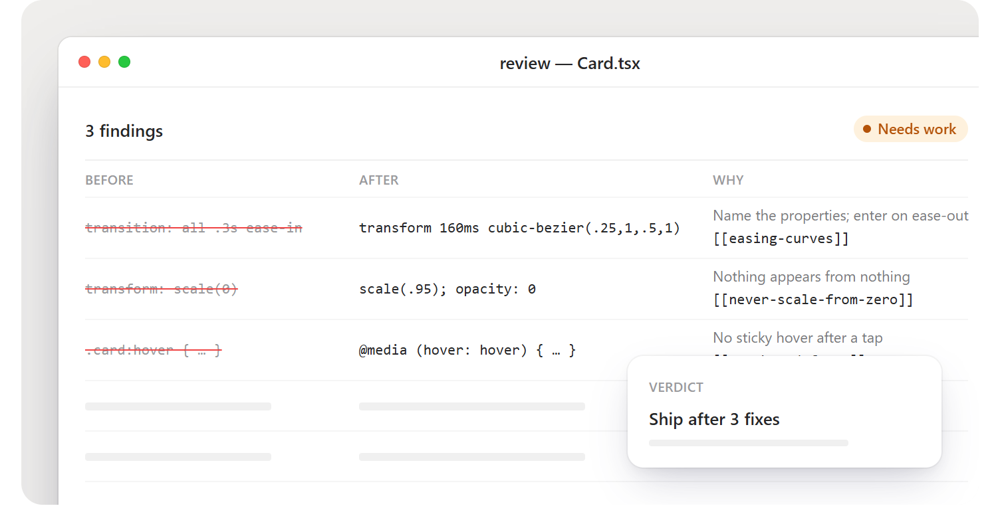
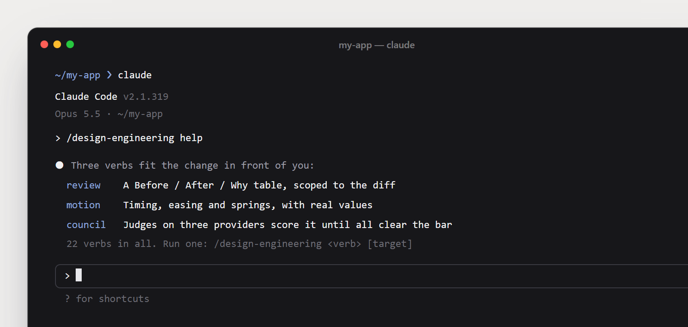
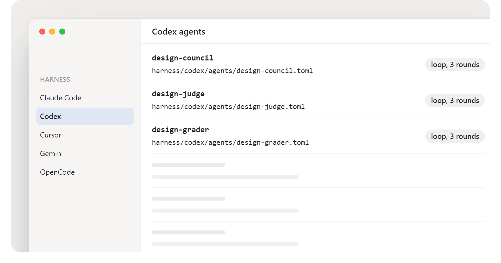
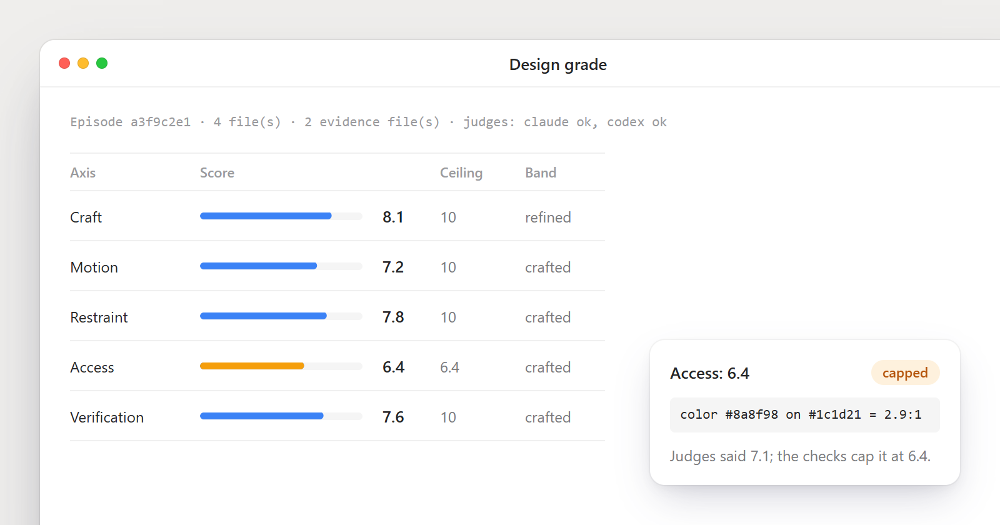
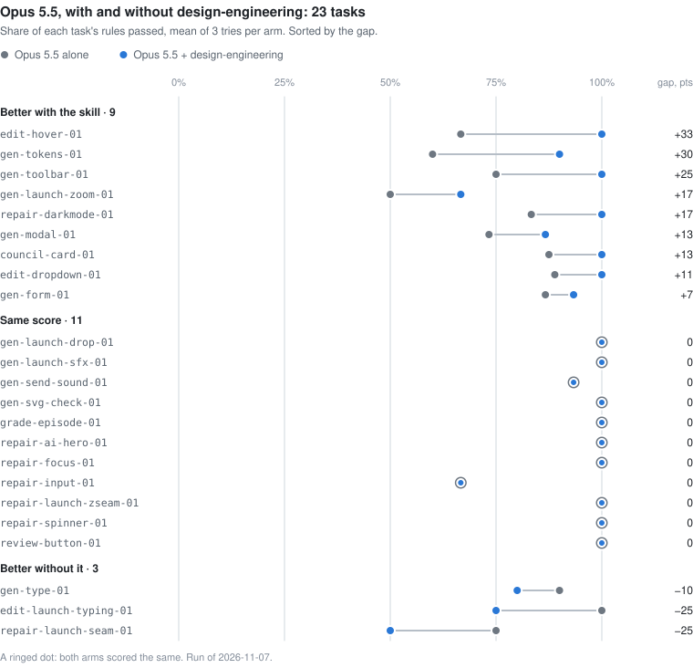
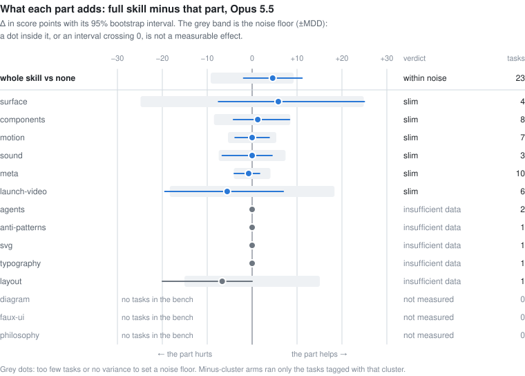
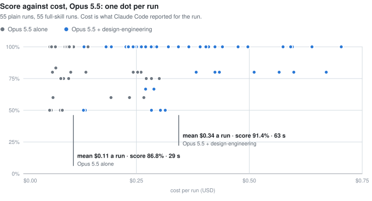
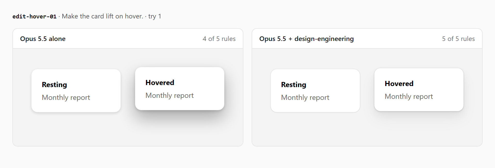
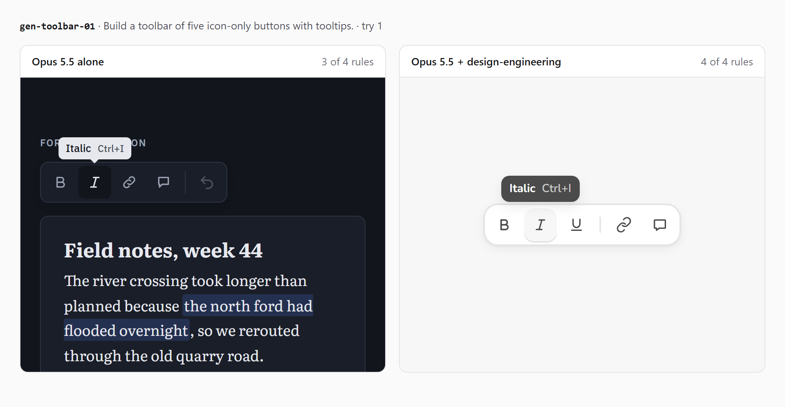

<p align="left">
  <picture>
    <source media="(prefers-color-scheme: dark)" srcset="docs/brand/agents-dark-bg.svg">
    
  </picture>
</p>

# design-engineering

[](https://skills.sh/AgentsORG/design-engineering)
[](https://github.com/AgentsORG/design-engineering/actions/workflows/ci.yml)
[](https://github.com/AgentsORG/design-engineering/releases)
[](LICENSE)

```bash
npx skills add AgentsORG/design-engineering
```

The details that make UI feel right, written down for your coding agent: a skill graph it loads, thirteen specialist agents that check their own work, a cross-model design council, a grader, and a benchmark that says plainly what all of it is worth. It runs in Claude Code, Codex, Cursor, Gemini CLI and OpenCode.



It draws on Emil Kowalski's practice, [Benji Taylor](https://benji.org) ([Agentation](https://www.agentation.com), [Stageshow](https://benji.org/stageshow)), [Jakub Antalik](https://transitions.dev), [Jakub Krehel](https://jakub.kr), [James Frewin](https://guidelines.sh), [Vercel](https://vercel.com/design/guidelines), [Index](https://index.how), Apple's audio-haptic principles and 47 launch films measured frame by frame. Every source is under [Sources](#sources).

## Install

**The skill.** Run the command at the top, then type `/design-engineering` in your agent. It works in any agent skills.sh supports.

**Everything.** One line installs the skill, the Claude Code plugin, the agents for every harness it finds and the design-check hook. The eve MCP server and companion skills are opt-in.

```bash
curl -fsSL https://raw.githubusercontent.com/AgentsORG/design-engineering/main/install.sh | bash
```

```powershell
irm https://raw.githubusercontent.com/AgentsORG/design-engineering/main/install.ps1 | iex
```


Add `--dry-run` to see every change first (`-DryRun` on Windows). The installer is idempotent, backs up any settings file before it edits one, never touches credentials, and `--uninstall` removes exactly what it wrote. It downloads only the latest release's ~1 MB install bundle; pin a release with `DE_REF=v4.2.3`. The flags, every path it writes and the manual steps for each harness, the plugin marketplace and the shadcn registry are in [docs/install.md](docs/install.md).

**Claude Code plugin only.** Inside Claude Code 2.1.275 or later: `/plugin install design-engineering --marketplace AgentsORG/design-engineering`.

Install the skill one way only. skills.sh gives you `/design-engineering`; the plugin gives you `/design-engineering:design-engineering`. With both, it is listed twice.

## Paste this into your coding agent

Give your agent this block and it installs and checks itself:

```text
Install and verify the design-engineering skill and agents for this machine.

1. Run the installer for this OS, dry run first, and show me the plan:
   macOS/Linux: curl -fsSL https://raw.githubusercontent.com/AgentsORG/design-engineering/main/install.sh | bash -s -- --dry-run
   Windows:     & ([scriptblock]::Create((irm https://raw.githubusercontent.com/AgentsORG/design-engineering/main/install.ps1))) -DryRun
2. If the plan only touches the skill, agent, hook and backup paths it lists, run it again
   without the dry-run flag (add --yes / -Yes so it does not prompt).
3. Verify, and report each line as pass or fail:
   - SKILL.md exists in the harness's skill folder (~/.agents/skills, ~/.gemini/skills or
     ~/.config/opencode/skills, under design-engineering/; in Claude Code it comes from the plugin)
   - /design-engineering with no arguments prints the verb menu
   - the agents are listed: design-council, design-judge, design-grader, ui-reviewer, motion-auditor
     (Claude Code: /agents, from the plugin; Codex: ~/.codex/agents; Cursor: ~/.cursor/agents;
      Gemini: ~/.gemini/agents; OpenCode: ~/.config/opencode/agents)
   - node <skill folder>/scripts/grade.mjs --self-test exits 0
   - ~/.config/design-engineering/manifest.txt lists everything that was written
4. Smoke test: run "/design-engineering review" on one CSS file in this repo and check the answer
   is a Before | After | Why table that cites node names like [[easing-curves]].
Never edit credentials. If a step fails, stop and show me the error.
```

## What you get

| Part | Claude Code | Codex | Cursor | Gemini | OpenCode |
| --- | --- | --- | --- | --- | --- |
| Skill graph and `/design-engineering` | plugin or skill | skill | skill | skill | skill |
| 13 specialist agents | plugin or `~/.claude/agents/` | `~/.codex/agents/*.toml` | `~/.cursor/agents/` | `~/.gemini/agents/` | `~/.config/opencode/agents/` |
| Loops (act, verify, fix, 3 rounds) | yes | yes | yes | yes | yes |
| Design council (`council.mjs`) | judge via `claude -p` | judge via `codex exec` | judge via `cursor-agent -p` | unscored jester via `gemini -p` | runs the runner |
| Grader (`grade.mjs`) | yes | yes | yes | yes | yes |
| Design-check hook | `PostToolUse`, non-blocking | not wired yet | not wired yet | not wired yet | not wired yet |
| eve MCP hand-off (opt-in) | `claude mcp add` | MCP settings | MCP settings | MCP settings | MCP settings |

Each agent is written once, in `plugin/agents/<name>.md`, and generated into every other harness's format by `scripts/build-agents.mjs`. Harness-by-harness detail is in [plugin/harness/README.md](plugin/harness/README.md).

## Taste: one brief, seven forks

![One brief, seven tastes: the same daily-reminder card (a title, one line, one value, a primary and a secondary button) drawn seven times. The default is a quiet white card with a near-black button; Duolingo has a lowercase green title and chunky lipped buttons; Campus Binge has one gradient word and a green pill on mint; Smash&Clash has a tilted sticker title and tilted candy buttons on navy lips over sky blue; Swiggy is a rounded white panel with orange pills on Salt; Cursor is warm paper with one orange button and a monospace schedule; Aave is warm white with periwinkle tints and a monospace health factor](docs/readme/img/pov-gallery.png)

[`references/meta/pov.md`](skills/design-engineering/references/meta/pov.md) is the taste layer: the one file where your opinions override the skill's canonical defaults, so the same request comes back in a different visual language. To switch, copy a fork over it (`cp skills/design-engineering/pov-examples/cursor.md skills/design-engineering/references/meta/pov.md` in this repo, or the same two paths inside your installed skill folder), or ask `/design-engineering pov` to fork your own.

| Fork | Stance | Still |
| --- | --- | --- |
| [Default](skills/design-engineering/references/meta/pov.md) | Restrained taste calls distilled from the graph: no motion unless it earns it, constraints from the brand, every colour scheme first-class | [pov-default.png](docs/readme/img/pov-default.png) |
| [Duolingo](skills/design-engineering/pov-examples/duolingo.md) | Physical, loud and kind: lipped buttons, colour that carries meaning, rounded lowercase type | [pov-duolingo.png](docs/readme/img/pov-duolingo.png) |
| [Campus Binge](skills/design-engineering/pov-examples/campus-binge.md) | Calm, green and type-led: one gradient word per headline, light only, soft layered depth | [pov-campus-binge.png](docs/readme/img/pov-campus-binge.png) |
| [Smash&Clash](skills/design-engineering/pov-examples/smash-and-clash.md) | A toy you can press: tilted candy slabs on a hard navy lip, one sun-yellow primary per screen | [pov-smash-and-clash.png](docs/readme/img/pov-smash-and-clash.png) |
| [Swiggy](skills/design-engineering/pov-examples/swiggy.md) | One orange pin, one typeface, one rounded panel; each business changes the lead colour, never the system | [pov-swiggy.png](docs/readme/img/pov-swiggy.png) |
| [Cursor](skills/design-engineering/pov-examples/cursor.md) | Warm paper, warm ink and one orange; a monospace only for what the machine says | [pov-cursor.png](docs/readme/img/pov-cursor.png) |
| [Aave](skills/design-engineering/pov-examples/aave.md) | Money software that feels friendly: warm-white calm and one periwinkle purple in tint steps | [pov-aave.png](docs/readme/img/pov-aave.png) |

Each card is drawn strictly from its file's stated colours, type, radii, depth, button construction, case rules and voice; no logo or mascot artwork is used. The scenes are in [docs/readme/stage](docs/readme/stage/README.md).

## Verbs



Everything goes through one skill: `/design-engineering [verb] [target]`. A plain request (`/design-engineering why does this card feel flat`) is routed to the one node that owns it. With no arguments it shows the menu and suggests the verbs that fit what is in front of it. The Pairs with column is read from each command file's Hand-offs section.

| Verb | Does | Pairs with |
| --- | --- | --- |
| `review` | A UI code review as a Before / After / Why table, scoped to the diff | `motion` when motion is most of it; `tells` for "looks AI-made"; `ship` for the whole app |
| `polish` | The screen works but feels unfinished: states, optical details, fixes applied | `motion` when motion feels off; `mobile` on a phone; `break` when data breaks it |
| `motion` | Whether it should move, then timing, easing and springs with concrete values | `film` for a launch film's motion; `svg` for an SVG that moves |
| `tells` | AI-default tells in UI, code or copy, as a deletion list | `options` for a new direction, only when asked |
| `a11y` | An evidence-only accessibility audit tied to WCAG 2.2 criteria | `review` for the whole screen |
| `tokens` | Find the `.design` / DESIGN.md and thread its tokens through the UI | `options` when there is no look yet; `polish` once tokens land; `review` for stale literals |
| `sound` | Which moments earn a sound; one family, generated, wired, mapped | `motion` first, for the contact frames; `film` for a film's score |
| `council` | Cross-model judges score before/after evidence per category until every judge passes | `review` for one opinion; `grade` for a report card; `stage` or `film` for evidence first |
| `grade` | Score a design episode, human or agent, on six axes | `council` to push the score up; `review` to fix one diff |
| `svg` | `create`, `animate` or `sticker` | `motion` for timing beyond the file; `sound` for a reveal; `stage` for a demo |
| `stage` | `still`, `demo`, `bento` or `review`: faux product UI, framed first and filmed | `polish` or `review` for a real screen; `film` when it becomes a film; `council` for judges |
| `mobile` | A web app that feels native on a phone: the symptom, the fix, what needs a real device | `motion` for gesture feel; `a11y` for keyboard and screen readers; `break` for overflow |
| `break` | Realistic worst-case data until the layout breaks; reports and stops | `review` or `polish` for taste; `mobile` for phone-only breaks; `motion` for what moves |
| `ship` | The whole-app production pass, then what still needs a device or a human | `review` for one diff; `break` on new user-data surfaces first |
| `film` | `plan` a launch film, `review` a render, or `formats` | `motion` for product UI motion; `sound` once picture locks; `stage` for the demo |
| `diagram` · `options` · `pick` · `name` · `which` · `agentation` · `pov` | Draw or not; three directions behind a picker; the exact word; who owns a job; the annotation fix loop; fork the taste or log a gotcha | Each hands off to one owner node and stops |

The 2.x commands (`/design-engineering:review-ui` and the rest) still work as aliases.

## Agents and loops



Thirteen specialists. Each is a delegation target, not an entry point: every verb runs without them.

| Agent | Job |
| --- | --- |
| `design-council` | Fans one judge brief out to every available provider and loops to the threshold |
| `design-judge` | One read-only judge: JSON scores per category, Before/After/Why evidence, confidence |
| `design-grader` | Grades a design episode for a human or an agent |
| `ui-reviewer` | Before / After / Why review against the checklist |
| `motion-auditor` | Timing, easing, transform-only, reduced motion |
| `anti-pattern-scanner` | AI-default, copy and code tells, as a deletion list |
| `agentation-fix-loop` | Works through Agentation annotations until none are pending |
| `design-md-consumer` | Reads `.design` / DESIGN.md and threads its tokens through the UI |
| `pov-curator` | Forks the taste into `pov.md`, logs gotchas |
| `sound-designer` | One sound family, generated, wired and mapped to motion |
| `svg-creator`, `svg-animator` | Clean, token-aware SVG, then its animation |
| `launch-film-analyst` | Measures a launch film against the 47-film corpus |

Every agent runs a loop: act, verify with a deterministic check where one exists, fix, for three rounds by default, keeping a ledger of findings (`blocker`, `should`, `nit`). A timeout is never approval, an agent never agrees just to end the loop, and when in doubt it deletes or narrows rather than adds.

## Design council


`/design-engineering council` adapts Theo Browne's [tstack](https://github.com/t3dotgg/tstack) council (MIT) to design.

- **Three providers.** Claude through the `design-judge` agent, GPT through `codex exec`, Gemini through `gemini -p` as an unscored jester. A missing provider is reported, never substituted.
- **Evidence, not code alone.** Judges see before/after screenshots or films beside reference products, and never see the target threshold.
- **Scores per category, 1 to 10.** Typography, hierarchy, colour and contrast, spacing and layout, motion, states, accessibility, copy.
- **Staged.** The cheapest judge goes first; the scarce ones join once it passes. It loops until every judge clears the threshold or the budget runs out.
- **Recorded.** A `## Council review` table goes in the PR, with `no score` where a judge did not answer.

The runner is [council.mjs](skills/design-engineering/scripts/council.mjs). It finds the `claude`, `codex`, `cursor-agent` and `gemini` CLIs on its own; `--dry-run` shows the brief and sends nothing.

## Grader



`/design-engineering grade` scores a design episode (the brief, the diff, rendered evidence and, optionally, the transcript) the same way for a human, an agent with the skill and an agent without it.

- **Checks first.** Deterministic checks run before any judge: checklist rows, AI-default and code tells, contrast numbers, motion values, reduced motion. A check can only cap a score; only judges raise it.
- **Six axes, 1 to 10.** Craft, Motion, Restraint, Access, Verification, and Direction when a human steered an agent. Each comes with its evidence, the case against it and a confidence.
- **Bands.** generated (under 4), passable (4 to 6), crafted (6 to 8), refined (8 to 9), reference-grade (9 to 10).
- **No re-rolls, nothing sent unasked.** Results are cached by input hash, secrets are scrubbed before any model call, and `--dry-run` shows what would be sent.

The rubric is [grading-rubric.md](skills/design-engineering/references/meta/grading-rubric.md) and the script is [grade.mjs](skills/design-engineering/scripts/grade.mjs): `node grade.mjs --files "src/**/*.tsx" --evidence after.png --judges claude,codex`, or `--checks-only`.

## Benchmarks

The bench asks one question: does an agent with the skill write better UI code than the same model without it? Every run is a fresh `claude -p` in an empty folder. The `none` arm has no design-engineering at all, the `full` arm has the whole plugin, and each `minus-<cluster>` arm has the plugin with one part removed. The bench checks every run's startup line to prove nothing leaked between arms, scores the answer against the task's rules, and records cost and time. It reports a gap only when it is bigger than the noise between tries.

The latest run: Opus 5.5, 23 tasks, 3 tries per task per arm, 219 runs in all ([REPORT.md](bench/results/2026-11-07-opus-ablation/REPORT.md)).

- **No measurable gain yet.** With the skill, Opus 5.5 passed 91.4% of the rules; without it, 86.8%. The gap is 4.6 points, with a 95% interval from −1.9 to +11.1. The smallest gap this run could tell apart from noise is 9.2 points, so this one is noise.
- **Opus 5.5 is a strong baseline.** On its own it passed every rule in 30 of its 55 runs; with the skill, 41 of 55.
- **It costs more.** A run with the skill cost $0.34 against $0.11, about three times as much, and took 63 s against 29 s, about twice as long. Most of the difference is the skill's notes being read.

<picture>
  <source media="(prefers-color-scheme: dark)" srcset="docs/readme/img/bench-tasks-dark.svg">
  
</picture>

The skill was ahead on 9 tasks, level on 11 and behind on 3. The clearest wins are the details it was written for: a hover lift kept small and gated to devices that can hover (`edit-hover-01`), colour tokens written in OKLCH (`gen-tokens-01`), icon buttons whose hover styles stay off touch screens (`gen-toolbar-01`), and a dark-mode card set apart by a lighter surface (`repair-darkmode-01`). The three losses:

- `repair-launch-seam-01` (−25): the task asks to stop a card that "never stops breathing", and in 2 of 3 tries the skill arm kept its endless `yoyo` loop.
- `edit-launch-typing-01` (−25): one skill-arm try typed at the right speed, 15 characters a second, but set it in a variable called `READ_CPS`, which the rule's pattern does not match. This loss is partly the scorer's.
- `gen-type-01` (−10): in 2 of 3 tries the skill arm left out a line length in `ch`.

<picture>
  <source media="(prefers-color-scheme: dark)" srcset="docs/readme/img/bench-clusters-dark.svg">
  
</picture>

Taking one part of the skill out at a time moved no score past its noise floor. Six clusters come out **slim**: on these tasks their effect is too small to see, so the advice is to trim their weight but keep the nodes that carry facts. Five have **too little data**: one or two tasks each, and for `agents` every try scored the same, which leaves no noise floor to judge against. Three are **not measured** at all, because no task exercises them: `diagram`, `faux-ui` and `philosophy`.

<picture>
  <source media="(prefers-color-scheme: dark)" srcset="docs/readme/img/bench-cost-dark.svg">
  
</picture>

What the bench does not measure yet: how the result looks. The rules are patterns over the code, so a modal can pass every rule and still look wrong, as the second example below shows. It also covers one model, and only two tasks touch the council and the grader.

Run it yourself (it uses your own Claude Code login):

```bash
node bench/bench.mjs --arms none,full --tries 3 --model opus             # with and without the skill
node bench/bench.mjs --arms all --tries 3 --relevant-only --concurrency 4 # every minus-<cluster> arm
node bench/bench.mjs --report-only --out bench/results/<run>              # rebuild REPORT.md and report.json
node bench/chart.mjs bench/results/<run>                                  # the three charts above
node bench/render.mjs bench/results/<run>                                 # the rendered examples below
```

Two other suites sit beside it: `claude plugin eval .` runs the cases in `bench/plugin/` with and without the plugin, and `npm --prefix eve run eval` runs the eve agent's checks. All three are described in [bench/README.md](bench/README.md).

## Sample prompts and outputs

The same prompt, both arms, from the run above (try 1), rendered in Chrome by `bench/render.mjs`.



**Make the card lift on hover.** Both answers named the transitioned properties, moved the shadow onto a layer that fades, and kept the lift off touch screens. Plain Opus kept the 4px jump and the 30% shadow; with the skill the lift is 2px and the shadow is three faint layers.


**Build a settings modal with an enter animation.** Both arms passed 4 of 5 rules, and here plain Opus looks better. The skill arm used uppercase button labels and a loud green. They came from [pov.md](skills/design-engineering/references/meta/pov.md), the taste file the skill loads, which at the time of this run was forked to Duolingo's design language. 4.1.0 ships a restrained default instead and keeps Duolingo, Campus Binge, Smash&Clash, Swiggy, Cursor and Aave as [example forks](skills/design-engineering/pov-examples/). The file is meant to be yours: fork it for your product.



**Build a toolbar of five icon-only buttons with tooltips.** Both are good toolbars with labelled buttons and tooltips. Plain Opus left its hover styles on for touch screens, where a tapped button stays highlighted; the skill arm gated them.

The answers as written, for two of the tasks:

<details>
<summary><code>edit-hover-01</code>: "Make the card lift on hover." Opus 5.5 alone, 4 of 5 rules</summary>

Input:

```css
.card { transition: all 0.3s ease-in; }
.card:hover { transform: translateY(-4px); box-shadow: 0 16px 32px rgba(0,0,0,0.3); }
```

Your version works, but I'd change three things:

- **`transition: all`** animates every property that changes, including ones you didn't mean to. List only the ones you want.
- **`ease-in`** starts slowly, so the hover feels laggy. `ease-out` responds right away and then settles.
- **Animating `box-shadow`** forces a repaint on every frame. It's smoother to put the large shadow on a pseudo-element and fade its `opacity`, which the GPU can handle on its own.

```css
.card {
  position: relative;
  border-radius: 12px; /* match your card */
  box-shadow: 0 2px 6px rgba(0, 0, 0, 0.15); /* resting shadow */
  transition: transform 0.25s cubic-bezier(0.2, 0.8, 0.2, 1);
}

/* Hover shadow, pre-rendered and faded in */
.card::after {
  content: "";
  position: absolute;
  inset: 0;
  border-radius: inherit;
  box-shadow: 0 16px 32px rgba(0, 0, 0, 0.3);
  opacity: 0;
  transition: opacity 0.25s cubic-bezier(0.2, 0.8, 0.2, 1);
  pointer-events: none;
  z-index: -1;
}

/* Only on devices that can really hover, so the lift doesn't stick on touch screens */
@media (hover: hover) and (pointer: fine) {
  .card:hover,
  .card:focus-within {
    transform: translateY(-4px);
  }
  .card:hover::after,
  .card:focus-within::after {
    opacity: 1;
  }
}

/* Respect the user's reduced-motion setting */
@media (prefers-reduced-motion: reduce) {
  .card,
  .card::after {
    transition: none;
  }
  .card:hover,
  .card:focus-within {
    transform: none;
  }
}
```

Notes:
- `:focus-within` makes keyboard users see the lift too when they tab to a link or button inside the card.
- `z-index: -1` keeps the shadow behind the card's content. If the shadow ends up hidden behind the card's parent, add `isolation: isolate;` to `.card`.
- If you don't want the pseudo-element, the simpler version is: `transition: transform 0.25s ease-out, box-shadow 0.25s ease-out;`

</details>

<details>
<summary><code>edit-hover-01</code>: the same prompt with design-engineering, 5 of 5 rules</summary>

I've finished reading the skill's notes on motion, hover and shadows. Here's the cleaned-up version:

```css
.card {
  position: relative;
  border-radius: 16px;
  box-shadow:
    0 0 0 1px rgba(17, 17, 17, 0.06),
    0 1px 2px rgba(17, 17, 17, 0.04);
  transition: transform 200ms cubic-bezier(0.25, 1, 0.5, 1);
}

/* The raised shadow sits on its own layer, so hover only changes opacity */
.card::after {
  content: "";
  position: absolute;
  inset: 0;
  z-index: -1;
  border-radius: inherit;
  pointer-events: none;
  box-shadow:
    0 2px 4px rgba(17, 17, 17, 0.05),
    0 8px 16px rgba(17, 17, 17, 0.05),
    0 16px 32px rgba(17, 17, 17, 0.05);
  opacity: 0;
  transition: opacity 200ms cubic-bezier(0.25, 1, 0.5, 1);
}

@media (hover: hover) {
  .card:hover {
    transform: translateY(-2px);
  }
  .card:hover::after {
    opacity: 1;
  }
}

/* Keyboard users get the same lift */
.card:focus-visible {
  transform: translateY(-2px);
}
.card:focus-visible::after {
  opacity: 1;
}

/* With reduced motion, drop the movement but keep the shadow fade */
@media (prefers-reduced-motion: reduce) {
  .card,
  .card:hover,
  .card:focus-visible {
    transform: none;
  }
}
```

What changed from your version:

| Before | After | Why |
|---|---|---|
| `transition: all` | Only `transform` and `opacity` are animated | `all` also animates any width, padding or color change on the card, which can make the page reflow and stutter on hover. |
| `ease-in` | `cubic-bezier(0.25, 1, 0.5, 1)` (an "out-quart" curve) | `ease-in` starts slowly, so the hover feels late. This curve starts moving right away and settles smoothly. |
| `0.3s` | `200ms` | 300ms feels slow for a hover. |
| `translateY(-4px)` | `translateY(-2px)` | 4px looks bouncy. The bigger shadow is what makes the card look raised, so it doesn't need to move far. Go down to `-1px` for a quieter look. |
| One shadow at 30% opacity | Three stacked shadows at about 5% each, plus a 1px outline | One strong shadow looks like a grey smudge. Stacked faint shadows look like real depth, and the outline keeps the top edge visible. |
| Animating `box-shadow` | Fading a shadow layer in with `opacity` | Animating `box-shadow` makes the browser repaint every frame. Fading opacity is much cheaper. |
| No touch gate | `@media (hover: hover)` | On phones, `:hover` sticks after a tap, so the card would stay raised. |
| — | `:focus-visible` and `prefers-reduced-motion` | Keyboard users see the same state. Users who turn off motion get the shadow without the movement. |

The `::after` layer uses `z-index: -1`, so the card needs a background color. If the card's parent has its own background, add `isolation: isolate` to `.card` so the shadow stays visible.

One note on the skill: it's set up for a Duolingo-style design (buttons with a thick bottom edge that press down, not lifting cards). You didn't say your project uses that style, so I used its general rules instead.

</details>

<details>
<summary><code>repair-input-01</code>: "Page zooms when tapping the search field on iPhone." Opus 5.5 alone, 1 of 2 rules</summary>

Input: `input[type=search] { font-size: 14px; }`

Both arms gave the right fix. This one lost a rule for showing the `maximum-scale` meta tag in a code block, even though it shows it as the thing to avoid.

iOS Safari zooms in on any form field whose computed `font-size` is below **16px** when it gets focus. Your search input is set to 14px, so it zooms. Set it to at least 16px:

```css
input[type=search] {
  font-size: 16px; /* iOS Safari zooms on focus below 16px */
}
```

To keep 14px on desktop and only bump it up on touch devices:

```css
input[type=search] {
  font-size: 14px;
}

@media (hover: none) and (pointer: coarse) {
  input[type=search] {
    font-size: 16px;
  }
}
```

Apply the same rule to `textarea`, `select` and any other input types that are also below 16px. Each of them triggers the zoom too:

```css
input, textarea, select {
  font-size: max(16px, 1em);
}
```

**Avoid the viewport hack.** You'll often see this suggested:

```html
<meta name="viewport" content="width=device-width, initial-scale=1, maximum-scale=1">
```

It does stop the zoom, but on Android it also blocks pinch-to-zoom, which is an accessibility failure under WCAG 1.4.4. Recent iOS versions ignore it for pinch-zoom anyway. The 16px font fix is the right one. Keep your viewport tag as:

```html
<meta name="viewport" content="width=device-width, initial-scale=1">
```

</details>

<details>
<summary><code>repair-input-01</code>: the same prompt with design-engineering, 2 of 2 rules</summary>

That zoom is iOS Safari's own behaviour. When a focused text field's computed `font-size` is under **16px**, Safari zooms in so the text is readable. At 14px, every tap on the search field zooms the page.

**Fix:** make the field's text at least 16px. If you want the denser 14px look on desktop, apply the 16px only on touch devices:

```css
input[type="search"] {
  font-size: 14px;
}

/* Touch devices: 16px or larger stops Safari's focus zoom */
@media (pointer: coarse) {
  input[type="search"] {
    font-size: max(16px, 1rem);
  }
}
```

If you'd rather use 16px everywhere, which is simpler and usually fine:

```css
input[type="search"] {
  font-size: max(16px, 1rem);
}
```

**Don't** fix it by adding `maximum-scale=1` or `user-scalable=no` to the viewport meta tag. It does stop the zoom, but it also stops users pinch-zooming the page on Android and some other browsers, which is an accessibility failure (WCAG 1.4.4, Resize Text). The font-size fix only changes the input.

**Don't** fix it with `transform: scale()` either, such as a 16px input scaled down to look like 14px. It messes up the caret, the text selection and the layout box.

**Check it on a real iPhone.** The desktop Simulator and responsive mode in Chrome DevTools don't reproduce the focus zoom. Also make sure no parent rule or utility class sets a smaller `font-size` on the input, because the computed size is what Safari checks.

</details>

## eve runtime

The `eve/` folder is a runnable [eve](https://eve.dev/) project: a durable backend design-engineering agent with the skill graph synced into its root and into every subagent, plus the same specialists, including a council with one nested subagent per provider.

```bash
cd eve
npm install
npm run dev      # syncs the skill graph into eve/agent/ and starts eve dev
npm run eval     # scored checks, including delegation and the council
```

It serves MCP at `http://localhost:2000/eve/v1/mcp`, so Claude Code, Codex and Cursor can hand work to it (`claude mcp add --transport http design-engineering http://localhost:2000/eve/v1/mcp`), and `npm run acp` serves ACP editors.

## Launch film


The first ten seconds of a 34.6 s film made with the skill's own launch-film and sound rules, then measured with the same script as the 47 reference films. [Watch it with sound](docs/demo/design-engineering-demo.mp4?v=2.6.0). The [HyperFrames](https://www.hyperframes.dev/design) source, storyboard and cue sheet are in [docs/demo/hyperframes/](docs/demo/hyperframes/STORYBOARD.md).

## Repository layout

```text
design-engineering/
├── README.md, AGENTS.md, CHANGELOG.md, LICENSE
├── install.sh, install.ps1            the one-line installers
├── plugin.json                        Agent Plugins manifest
├── .claude-plugin/ .codex-plugin/ .cursor-plugin/ .plugin/   host manifests
├── .github/                           CI, CONTRIBUTING, CODE_OF_CONDUCT, SECURITY, markdownlint config
├── skills/design-engineering/         the skill
│   ├── SKILL.md                       the map, one /design-engineering entry
│   ├── references/                    themed clusters of linked nodes, plus the verb files
│   ├── scripts/                       council.mjs, grade.mjs, sound and SVG tools
│   └── evals/                         routing fixtures and design-bench.jsonl
├── plugin/
│   ├── agents/                        the 13 agents, written once (Claude Code format)
│   ├── harness/                       generated: codex/, cursor/, gemini/, opencode/
│   └── hooks/                         the design-check hook and its settings merge
├── eve/                               the eve app: agent/, evals/, scripts/sync-skills.mjs
├── bench/                             bench.mjs, chart.mjs, render.mjs, run-bench.mjs, plugin/ suite, results/
├── registry/                          shadcn registry.json, built r/ items, a starter .design
├── scripts/                           build-agents, build-registry, release
└── docs/                              install.md, subagents.md, SOUL.md, NOTICE.md, spec/, template/,
                                       readme/ (this page's scenes and images), demo/, research/
```

The skill is a graph, not one file: `SKILL.md` links to a hub per theme (`references/<theme>/MOC-<theme>.md`), and each node is one complete thought with `[[wikilinks]]` that resolve by name. Open `skills/design-engineering/` as an [Obsidian](https://obsidian.md) vault to browse it as a graph. To make it yours, edit `references/meta/pov.md` (your taste) and `references/meta/gotchas.md` (one line for each detail your agent got wrong).

The stills on this page are faux product UI built with [Stageshow](https://benji.org/stageshow) (MIT, Benji Taylor). The scenes and how to re-film them are in [docs/readme/stage/](docs/readme/stage/README.md).

## Contributing

PRs welcome; the shorter the better. Edit agents only in `plugin/agents/` and run `node scripts/build-agents.mjs`: CI fails if `plugin/harness/` or `eve/agent/subagents/` drift. CI also runs markdownlint, frontmatter checks, wikilink resolution and version parity across the manifests ([ci.yml](.github/workflows/ci.yml)). See [CONTRIBUTING.md](.github/CONTRIBUTING.md), [CODE_OF_CONDUCT.md](.github/CODE_OF_CONDUCT.md), [SECURITY.md](.github/SECURITY.md) and [CHANGELOG.md](CHANGELOG.md).

## Sources

- **Emil Kowalski** — [emilkowalski/skills](https://github.com/emilkowalski/skills) (MIT, commit `715c180`, read 2026-11-09), [emilkowal.ski](https://emilkowal.ski), [sonner.emilkowal.ski](https://sonner.emilkowal.ski)
- **Index (Emil Kowalski & Glenn Carstens-Peters)** — [index.how](https://index.how)
- **Benji Taylor** — [benji.org](https://benji.org) + [Agentation](https://www.agentation.com) + [Stageshow](https://github.com/benjitaylor/skills) (MIT): the faux-ui cluster (product shots, cursor demos, bento grids, filming them), `stageshow-reconciliation`; Honk's presence patterns, Drawesome's toolbar and Liveline's live-data states
- **Jakub Antalik** — [transitions.dev](https://transitions.dev)
- **Meta** — [Astryx](https://astryx.atmeta.com) ([github.com/meta/astryx](https://github.com/meta/astryx), MIT): `press-and-pending-states`, `hover-intent-timing`, `reduced-motion-by-pointer`, `overlay-dismissal-stack`, `mobile-type-pin`, `reorder-insertion-cue` and `astryx-reconciliation`
- **shadcn** — [shadcn/ui](https://ui.shadcn.com/) (MIT) and its [AI Elements](https://ui.shadcn.com/docs/ai-elements): `shadcn-reconciliation`, `streaming-chat-scroll` and `agent-trace-states`
- **Lochie Axon** — [skullet](https://github.com/lochie/skullet), [torph](https://github.com/lochie/torph) and [web-haptics](https://github.com/lochie/web-haptics) (all MIT; [skullet.lochie.me](https://skullet.lochie.me), [torph.lochie.me](https://torph.lochie.me), [haptics.lochie.me](https://haptics.lochie.me)): `measured-skeletons`, `text-morph-engine`, `haptic-feedback` and `web-haptics-reconciliation`
- **Jakub Krehel** — [jakubkrehel/skills](https://github.com/jakubkrehel/skills) (MIT) and [Interfaces](https://interfaces.dev/): the screen-reader, keyboard, WCAG 2.2, colour-token, palette-role, gradient, grouping, overflow, RTL, string, destructive-action, change-scoped review, stress-scenario and reading-other-interfaces nodes; `interfaces-reconciliation` says where its values differ from this graph's
- **OpenAI / Studio Dumbar/DEPT** — [*Refreshed.*](https://www.youtube.com/watch?v=k3d_xeVxEOE) and [*Introducing GPT-5*](https://www.youtube.com/watch?v=boJG84Jcf-4), measured for the bed-and-clicks register; [case study](https://studiodumbar.com/work/openai-brand-film)
- **Skale** — 28 client films and the 2025 reel from [skale.solutions/portfolio](https://skale.solutions/portfolio), measured for cuts, stillness, structure and sound (2026-09-28)
- **Acclaimed launch films, 2024–2026** — Linear Agent, Raycast, Claude Cowork and Claude Opus 4.6 (Anthropic; Opus 4.6 by BUCK per brief), Cursor 2.0, Notion Mail, Notion 3.0, Granola 2.0, Figma glass, Figma Motion, Framer 3.0 (maker uncredited), Spline Hana, Arc on Windows (The Browser Company), Apple Liquid Glass, Material 3 Expressive (Google Design), Perplexity Comet (Studio Freight), Google Gemini app and Google AI Mode (Ordinary Folk; inferred for AI Mode) — 18 films measured on 2026-09-28; the film list and every number in [`docs/research/launch-films/`](docs/research/launch-films/)
- **HeyGen** — [hyperframes-launches](https://github.com/heygen-com/hyperframes-launches) (launch-video seams, storyboards, audio cue maps, a 3,446-call tween census, three verification renders; Apache-2.0 code and timing only, no bundled media, marks or fonts)
- **HeyGen HyperFrames skills** — [heygen-com/hyperframes](https://github.com/heygen-com/hyperframes) (Apache-2.0), the build owner for rendered films; its repo-internal `.agents/skills/` doctrine is not installed by `npx skills add`, and `hyperframes-reconciliation` says where its values differ from this graph's
- **Apple** — [Designing Audio-Haptic Experiences (WWDC19)](https://developer.apple.com/videos/play/wwdc2019/223/), [HIG: Playing audio](https://developer.apple.com/design/human-interface-guidelines/playing-audio), [Twenty Thousand Hertz: The Sound of Apple](https://www.20k.org/episodes/the-sound-of-apple)
- **bruno (@tvnxty)** — [superfx.co](https://superfx.co); the [Base logo reveal](https://x.com/tvnxty/status/2095601307444728212) whose sound map anchors `launch-video-sound`
- **Studio Dumbar/DEPT** — [OpenAI brand motion + sound](https://studiodumbar.com/work/openai)
- **Josh Comeau** — [use-sound](https://github.com/joshwcomeau/use-sound)
- **ElevenLabs** — [Text to sound effects API](https://elevenlabs.io/docs/api-reference/text-to-sound-effects/convert)
- **Stability AI** — [Stable Audio 3 Small-SFX](https://huggingface.co/stabilityai/stable-audio-3-small-sfx); **KilledByAPixel** — [ZzFX](https://github.com/KilledByAPixel/ZzFX); **Kenney** — [Interface Sounds](https://kenney.nl/assets/interface-sounds); **soundcn** — [soundcn.xyz](https://www.soundcn.xyz/); **Freesound** — [APIv2](https://freesound.org/docs/api/)
- **ITU-R BT.1359** — audio/video sync thresholds
- **Emil Kowalski's design-engineering practice, distilled by AgentsORG** — the typography, color, surfaces, forms, touch, polish, performance, component-API, marketing, prototyping, tooling, docs, unslop, and skill-writing nodes are distilled from it; glosses and rules are this graph's own
- **supermemoryai/skills** — [svg-animations](https://github.com/supermemoryai/skills/blob/main/svg-animations/SKILL.md) (engine choice, stroke drawing, SMIL timing, morphing rule)
- **Cathryn Lavery** — [diagram-design](https://github.com/cathrynlavery/diagram-design) (MIT): the deletion-first figure rules, connector rules, type ramp and motion clock behind the `diagram` cluster
- **tldraw** — [tldraw offline](https://github.com/tldraw/tldraw-offline)'s agent skill (cited, not copied; the app is not open source) and the [tldraw MCP app](https://github.com/tldraw/tldraw/tree/main/apps/mcp-app), behind `tldraw-canvas`
- **Adrian Abelarde** — [Anim8](https://www.tryanim8.com/), the MP4 → editable animated SVG pipeline behind `video-to-vector-pipeline`; **visioncortex/vtracer**, Potrace, SVGO
- **WebPAI DesignBench** — [arXiv 2506.06251](https://arxiv.org/abs/2506.06251) (generation / edit / repair tasks and metrics); **Design Arena** — [methodology](https://notes.designarena.ai/methodology/) (anonymous pairwise votes, Bradley-Terry)
- **Companions the router hands off to** — [AgentsORG `.design`](https://github.com/AgentsORG/DESIGN), [impeccable](https://impeccable.style/), [HyperFrames](https://www.hyperframes.dev/design), ElevenLabs, [shadcn CLI](https://ui.shadcn.com/docs/cli), [diagram-design](https://github.com/cathrynlavery/diagram-design), [tldraw](https://github.com/tldraw/tldraw) (Desktop's agent skill, the MCP app, `tldraw-migrate`), [GSAP skills](https://github.com/greensock/gsap-skills), [better-icons](https://github.com/better-auth/better-icons), [cinetic](https://github.com/Leonxlnx/cinetic) (Remotion builds), [earshot](https://github.com/Leonxlnx/earshot) (listening and the effects bank), [taste-skill](https://github.com/Leonxlnx/taste-skill) (opt-in), [interfaces](https://github.com/jakubkrehel/skills) (`/interface-review`, `/break`, `/state-machine`, `/variant`, `/explain-interface`, `build-design`, `teardown`), [web-haptics](https://github.com/lochie/web-haptics) (mobile-web haptics), [Astryx](https://github.com/meta/astryx) (its CLI and MCP in Astryx apps), [AI Elements](https://ui.shadcn.com/docs/ai-elements) (agent interfaces)
- **James Frewin** — [guidelines.sh](https://guidelines.sh)
- **Vercel** — [vercel.com/design/guidelines](https://vercel.com/design/guidelines)
- **Ben DC** — [github.com/bendc/frontend-guidelines](https://github.com/bendc/frontend-guidelines)
- **dmytro / @pqoqubbw** — [lucide-animated.com](https://lucide-animated.com)
- **DiceBear** — [dicebear.com/styles](https://www.dicebear.com/styles)
- **Google Labs Code** — [github.com/google-labs-code/design.md](https://github.com/google-labs-code/design.md) (mirrored in `docs/spec/`)
- **AgentsORG `.design`** — [github.com/AgentsORG/design](https://github.com/AgentsORG/design) (the `design.v1` visual contract; mirrored in `docs/spec/`)
- **agentskills.io** — [Agent Skills specification](https://github.com/agentskills/agentskills) (mirrored in `docs/spec/`)
- **Akshay Pachaar** — [Skill Graphs > SKILL.md](https://x.com/akshay_pachaar)
- **Perplexity Agents team** — [Designing, Refining, and Maintaining Agent Skills](https://research.perplexity.ai/articles/designing-refining-and-maintaining-agent-skills-at-perplexity)
- **Theo Browne** — [t3dotgg/tstack](https://github.com/t3dotgg/tstack) (MIT): the council pattern behind `design-council`, adapted and paraphrased, and the hill-climb in "Agents Sucked At UI (Until Today)"
- **Anthropic** — [anthropics/skills](https://github.com/anthropics/skills) (`spec/` + `template/` layout)

## See also

- [Agent Plugins spec](https://agent-plugins.org/) — the portable-plugin interoperability floor this repo conforms to
- [eve](https://eve.dev/) — the durable-agent framework the `eve/` runtime targets
- [skills.sh](https://skills.sh) — the CLI and registry
- [Agent Skills spec](https://agentskills.io/specification) — frontmatter and directory standard
- [agents.md](https://agents.md) — the AGENTS.md format
- [steipete/SOUL.md](https://github.com/steipete/SOUL.md) — identity layer for agents
- [design.md](https://github.com/google-labs-code/design.md) — design-token format for coding agents
- [.design](https://github.com/AgentsORG/design) — the `design.v1` living visual contract this skill defers to
- [shadcn registry](https://ui.shadcn.com/docs/registry) — how the `registry/r/` items are consumed
- [Agentation](https://www.agentation.com) — click-to-annotate design review
- [kepano/obsidian-skills](https://www.skills.sh/kepano/obsidian-skills) — edit skill graphs in Obsidian

## License

MIT. See [LICENSE](LICENSE).
